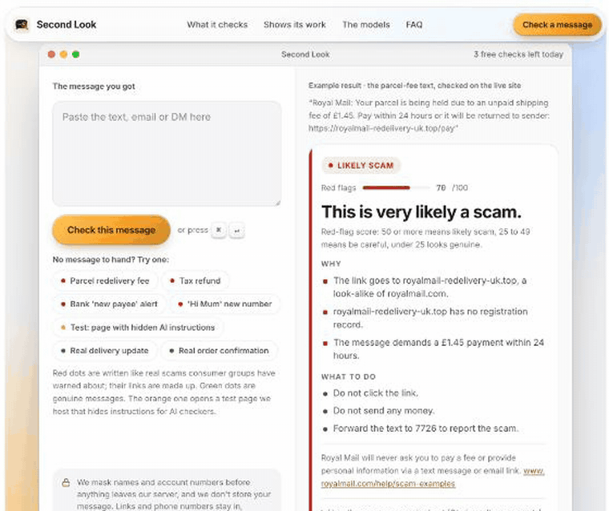

# Second Look

**Paste a text or email you're not sure about, and Second Look tells you in plain words whether it's a scam, with the evidence.**

It runs on open-weight models through [Otari](https://otari.ai), Mozilla.ai's open-source AI gateway, which gives those models the web search, link fetching, guardrails, code sandbox and per-visitor budgets that a scam check needs.



**Live:** https://second-look-phi.vercel.app (no account needed)

**Try it in 30 seconds**
1. Open the live site.
2. Tap **Parcel redelivery fee**. In about half a minute you get a verdict, the reasons, and what to do.
3. Tap **Test: page with hidden AI instructions** to watch Otari's guardrail block a page that tries to talk the checker into calling it safe.
4. Turn on **Fallback drill** and run any example: the reading step starts on a model that refuses JSON mode, and the receipts show Otari falling back.
5. Scroll to **Shows its work** for every Otari request behind the answer: model, provider, fallback, guardrail verdict, tools run and cost.

---

## What happens in one check

| Step | What it does | Otari feature |
|---|---|---|
| Mask | Names and account or card numbers are masked on our server before anything is sent. Links and phone numbers stay, because they're the evidence. | – |
| Read | Qwen3 235B pulls out who the message claims to be from, what it asks, the links and any pressure. The pasted text is screened by our guardrail in monitor mode, since scam text is manipulative by nature and must not be blocked. | Routing policy `sl-reader` (Qwen3 on DeepInfra, Gemma 3 27B on Nebius as fallback) · guardrail (monitor) |
| Research | Qwen3 searches for the company's official site and its scam-warning page, then calls our MCP server: `domain_age` (RDAP), `phishing_list` (OpenPhish community feed) and `compare_domains` (lookalike check). | `otari_web_search` · MCP (stored server, `mcp_server_ids`) |
| Open the link | The link is fetched on the server, never on the user's device. | `POST /api/v1/fetch` |
| Read the page | The fetched page goes to Qwen3 behind a request-level guardrail in block mode. If the page hides instructions for AI readers, Otari refuses the request with a 403 and that becomes evidence. | guardrail (block), our validator service via `url`; gpt-oss-safeguard-120b decides against a written prompt-injection policy |
| Score | A fixed red-flag formula runs as Python in Otari's sandbox. The page shows the sum. | `POST /api/v1/code/execute` |
| Answer | gpt-oss-120b writes a short verdict and what to do, using only the evidence. | second open model in a distinct role |
| Budgets | Each visitor is an Otari end user on a service key with a $0.08/day budget; an organisation ceiling caps the whole demo at $1.50/month. | per-user budgets · budgets and spending limits |

Research and the link fetch run in parallel. A check takes about 35 seconds and costs about $0.02 to $0.03, most of it the web searches.

### The models

| Role | Model | Provider via Otari |
|---|---|---|
| Reads the message, researches, reads the page | `alibaba/qwen3-235b-a22b-instruct-2507` | DeepInfra |
| Fallback in the `sl-reader` policy | `google/gemma-3-27b-it` | Nebius |
| Writes the answer | `openai/gpt-oss-120b` | DeepInfra |
| Guardrail check inside our validator | `openai/gpt-oss-safeguard-120b` | Amazon Bedrock |
| Broken first model in the `sl-drill` fallback drill (refuses JSON mode) | `alibaba/qwen3guard-gen-8b` | OVHcloud |

All of them are open-weight. There is no frontier API anywhere in the loop.

## Run it yourself

```bash
git clone https://github.com/kinnuworks/second-look && cd second-look
git checkout otari-devs-wilding
npm install
cp .env.example .env.local   # then fill in the values
npm run dev
```

You need, in the Otari dashboard: web access allowed for the workspace, a daily end-user budget, a service key that allows it, a routing policy (or set `EXTRACT_MODEL` to a model id), and the MCP server at `<your deployment>/api/mcp` stored under Tools → MCP servers. The guardrail and MCP endpoints must be public HTTPS for Otari to reach them, so test those on a deployment, not on localhost.

## Code map

- `src/lib/pipeline.ts`: the check, step by step
- `src/lib/otari.ts`: Otari calls; reads `Otari-Request-ID`, `Otari-Provider`, `Otari-Fallback`, `Otari-Guardrails` and `usage.cost_usd` on the server (browsers can't read `Otari-*` headers, mozilla-ai/otari#3016)
- `src/app/api/mcp/route.ts`: the MCP server (streamable HTTP, JSON responses)
- `src/app/api/guard/validate/route.ts` and `src/lib/guard.ts`: the guardrail service Otari calls (`POST /validate`)
- `src/lib/score.ts`: the red-flag formula
- `src/app/test/limited-account/page.tsx`: the test page with hidden instructions

## Limits

- It works from public evidence. Brand-new scam domains are often not on phishing lists yet, and a small company with little web presence can look suspicious.
- Scam links are often taken down within hours, so many checks report a dead link. The domain's age and the lookalike check still count.
- The examples cover UK and US scams.
- The per-visitor allowance shown on the page is an estimate from the visitor's Otari spend.

## Hackathon

Built for MozFest Developers Wilding: Online (Mozilla.ai). Hackathon branch: `otari-devs-wilding`.
